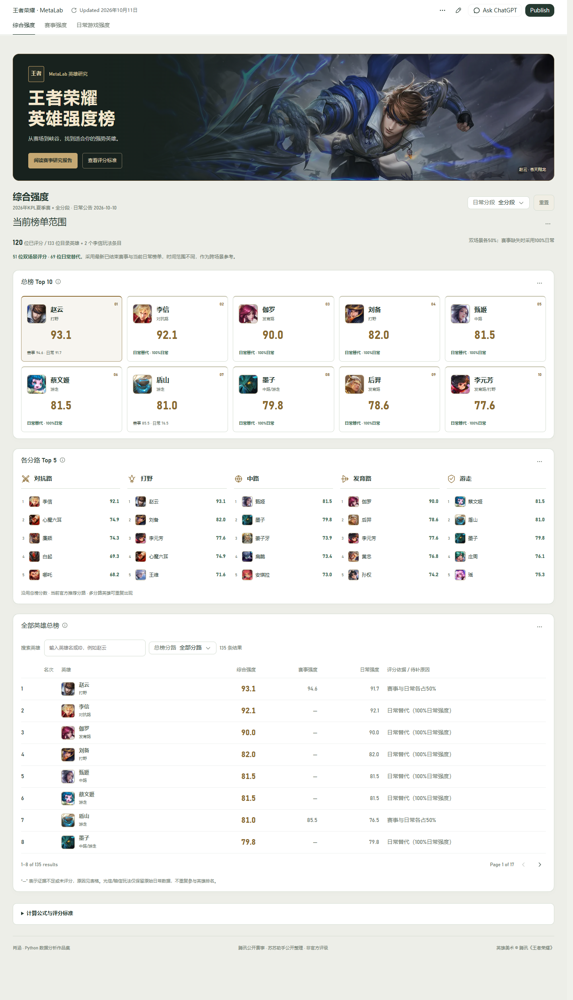

# HoK MetaLab · 王者荣耀英雄强度分析

[公开作品集](https://hanx-lucas.github.io/hok-metalab/) · [网页研究报告](https://hanx-lucas.github.io/hok-metalab/reports/index.html)



作者：肖涵。基于公开真实数据的Python分析与交互作品集，提供综合强度、赛事强度、日常游戏强度三个入口。每个入口包含总榜Top10、五个分路Top5、全部英雄搜索、英雄详情与数据来源。

## 数据与评分

- 腾讯公开赛事：2019–2026年33届，2,754条英雄×赛事观察；32届结束、1届进行中。
- 当前目录：133位英雄；日常公开样本：四档分段538条、四位英雄39,344条日期记录。日常由苏苏助手公开整理，尚未营地官方对账，来源没有样本场次；没有完整全英雄历史或可靠游戏S赛季映射。
- 赛事指数T：60%平滑胜率分位 + 25%出场率分位 + 15%ban率分位；乘100。Beta(10,10)平滑，至少30场且三项指标有效才排名。
- 日常指数D：同日期、同分段三项指标分位数，权重60%/25%/15%；乘100。
- 综合指数C：双场景有效时50%T + 50%D；没有有效赛事评分时100%D，并标记“日常替代”。日常指标缺失者不评分。
- 分位数为平均秩/有效英雄数。指标表示相对表现，赛事与日常的日期和环境不同；跨场景综合是项目设定，不代表官方评级或因果强度。

[完整计算标准](docs/downloads/强度榜计算标准.md) · [来源核验](docs/downloads/替代数据源核验.md) · [技术栈与面试指南](docs/downloads/项目说明与面试指南.md)

## 实现与复现

Python、Pandas、NumPy、SciPy、scikit-learn、SQLite、Matplotlib、ReportLab；网页内容使用React、Recharts和Codex Data Analytics公共运行时。Pages直接发布已经构建的静态HTML/JSON，无服务器、无登录、无需Codex即可浏览。

```bash
python -m venv .venv
# 激活环境后：
python -m pip install -r requirements-lock.txt
python run.py --offline
python -m unittest discover -s tests -v
python -m http.server 4173 --directory docs
```

匿名公开原始响应及SHA-256元数据在`data/raw/`。源表缺失不补零、不制造样本数。原课程手工Excel未在此仓库分发，重跑会跳过缺失的原手工表；它们不参与新版强度评分。`run.py --refresh`刷新腾讯数据；`scripts/prepare_daily_sources.py --refresh`刷新已验证的9个公开日常请求，保留原始响应。

`site/src/content/`和`report-app/src/content/`保留作者页面内容及主题源码。共享运行时不是本项目从零研发，网页重建需要安装Codex Data Analytics插件的官方构建工具；当前仓库不复制其受保护源码。`docs/`内完整构建成果可以直接托管。报告绘图及PDF重建需要中文字体；当前配置Windows微软雅黑。

## 发布与更新

GitHub Pages配置：main分支、`/docs`目录。刷新并检查数据、重建网页、按发布清单更新`docs/`后提交推送。网站展示当前构建快照，不自动抓取或定时刷新。单独上传HTML会缺少内容寻址JSON，需一起保留`data-app-build.json`和对应的`snapshot.*.json`。

## 归属

赛事及英雄目录来自腾讯公开接口；日常来自[苏苏助手](https://pvp.91m.top/ranking)。英雄头像与赵云原画版权归腾讯《王者荣耀》，用于非商业作品集展示，来源与hash见[美术清单](docs/downloads/hero_art_manifest.json)。前端设计参考Anthropic的frontend-design技能，原文本与许可证位于`research/`。页面公共运行时与依赖属于其各自作者；[技能与开源参考](docs/downloads/技能与开源参考.md)保留归属说明。
